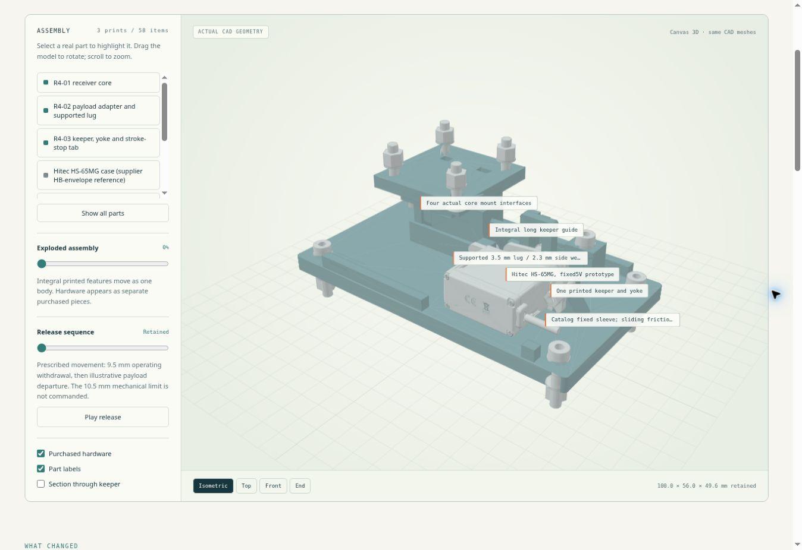
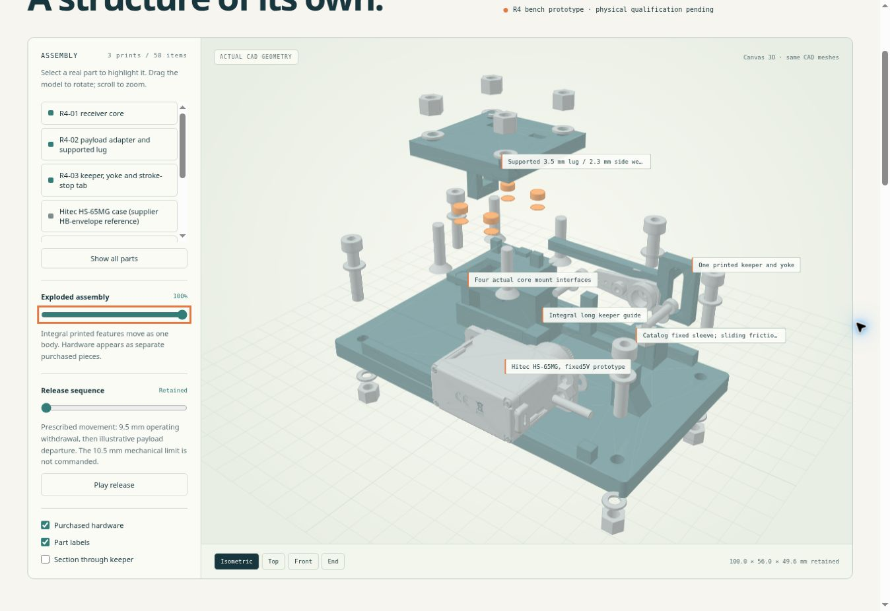

# R4 verification record

The complete local development run regenerated the nominal CAD and solved **42 component/load/mesh combinations**. It passed all **678 nominal CAD checks**, the exact load/support surface audit, the fresh manufacturing handoff, and the numerical consistency gates. The executable validation suite has **33 tests**; the bench controller and manual calibration helper have **16 tests**.

This record accompanies the actual [simulation report](../analysis/evidence/report.md), [summary](../analysis/evidence/summary.json), [gate](../analysis/evidence/validation-gate.json) and [file manifest](../analysis/evidence/evidence-manifest.json). The local result records the checkout's parent commit and individual source hashes because the new revision was not yet committed when it ran. A subsequent GitHub Actions run records its own checked-out revision and run ID. The committed archive never substitutes for a fresh CI solve.

After this local run, the workflow timeout was increased from 45 to 90 minutes to accommodate hosted-runner variation, and artifact names gained `run_attempt` so reruns preserve separate evidence without upload-name collisions. These orchestration changes do not change the CAD or numerical model. The original workflow hash in the local record is preserved; the final workflow is verified by its own Actions run.

## Findings that matter to the prototype

| Finding | Interpretation and next evidence |
|---|---|
| Receiver displacement is 0.01583 mm at 2 g plus the 3 N preload sensitivity. | This is the rigid host-interface, isotropic comparison model. Host compliance remains an integration input. |
| The largest finest-pair displacement change is 3.21%; several raw stress peaks remain mesh-sensitive. | Numerical consistency is established for this run. Strength convergence and a material allowable are not established. |
| At the last 0.1 mm of prescribed lug contact, raw compression reaches 63.0 MPa in the adapter and 58.1 MPa in the keeper. | This narrow-contact condition needs the specified loaded-release, wear and damage inspections. These numbers are not a PAHT-CF strength pass. |
| The 12 N blocked-tip keeper fixture deflects 1.173 mm. | That fixture omits the installed guide support. It exposes a component sensitivity; it is not an assembled release-clearance prediction. Separate gauge-relative component maxima cannot be added. |
| Assumed guide/sleeve friction pairs give peak crank demand from 8.85 to 65.56 N·mm. | Demand calculations do not prove servo output. B03 measures the full mechanism torque path and warm actuator capacity at the same angle, speed and representative shaft side load. |

The numerical material is the existing solid isotropic PLA comparison proxy, E = 2200 MPa and ν = 0.35. The proposed printed material is PAHT-CF. No modulus ratio, supplier tensile figure or smoothed peak is used to assign a payload rating.

## Buildability and viewer review

The manufacturing package contains exactly three single-solid structural prints. Each includes its integral features and remains a single object in the exploded view. Purchased fasteners, pads, horn and sleeve are separate assembly items.

The assembly sequence was checked with the removable open-stop screw absent: the keeper/horn/sleeve subassembly enters from +X, the servo enters from −Y onto the held spline, and the stop is installed afterward. This avoids trapping the integral keeper/yoke behind a permanent stop. The final pad placement also leaves a finite web to the adjacent socket rather than a tangent boundary.

The browser review used the committed CAD meshes and local viewer dependencies. It checked the assembled view, whole-print explosion, release controls, part selection, drawing links and the actual-result table. The software Canvas renderer was exercised because WebGL was unavailable in the review browser.

### Assembled

### Exploded

## Physical work remains explicit

All bench measurement fields remain **PENDING**. The [qualification procedure](qualification.md) specifies dimensional and preload inspection, static holds, 300 loaded releases across three specimens and four conditions, torque measurements, power-loss holds and midstroke observations. The controller ships with calibration disabled until measured endpoints are entered. Passing the software workflow does not change these statuses or establish flight qualification.
